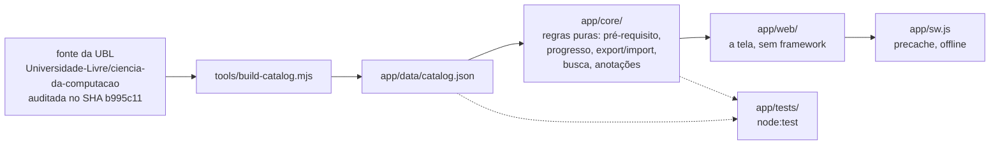

# Atlas — Ciência da Computação

A trilha de Ciência da Computação da **Universidade Brasileira Livre (UBL)** em
forma de app: mostra as 35 disciplinas, o que o seu progresso já destrancou e o
que estudar em seguida. Sem conta, sem servidor, sem dependência.

<p align="center">
  <!-- O selo de testes volta aqui quando o GitHub Actions do repositorio religar. -->
  <a href="LICENSE"></a>
  
  
</p>

Projeto independente e não oficial. O currículo, os recursos e a bibliografia são
da Universidade Brasileira Livre e dos seus contribuidores (veja
[CREDITS.md](CREDITS.md)). O Atlas é uma forma de estudá-los.

## Para quem é

Para quem estuda Ciência da Computação sozinho, pela grade aberta da UBL, e
precisa responder duas perguntas sem depender de ninguém: **o que eu já posso
estudar** (o que os pré-requisitos deixam) e **o que vem em seguida**. Roda no
celular, instala como aplicativo, funciona sem internet e não guarda nada seu
fora do seu aparelho.

## Abrir

- **Online:** [atlas-ciencia-da-computacao.pages.dev](https://atlas-ciencia-da-computacao.pages.dev/)
  — no ar, publicado pelo Cloudflare Pages a cada push no `main`, servindo a pasta
  [`app/`](app).
- **No celular:** abra o endereço acima e use o **Adicionar à tela inicial** do
  navegador (no Chrome do Android, *⋮ → Adicionar à tela inicial*; no iOS,
  *Compartilhar → Adicionar à Tela de Início*). O Atlas passa a abrir como
  aplicativo, e a trilha inteira fica no cache — abre sem internet depois disso.
- **No computador:** veja *Rodar e testar*, abaixo.

## O que faz

**A trilha**

- As 35 disciplinas obrigatórias da fonte, com pré-requisitos, organizadas em
  estágios — cada uma diz o que precisa estar concluído antes.
- O que está destrancado agora e o que estudar em seguida, calculado a partir do
  que você marcou (as regras ficam em [app/core/progress.js](app/core/progress.js),
  com detecção de ciclo e alcance de pré-requisito).
- Busca no topo que filtra grade, eletivas e especializações pelo nome, sem
  acento nem caixa importarem (`calculo` acha *Cálculo*). Sem resultado, a tela
  diz que não achou, em vez de ficar muda.
- Eletivas em seção própria, marcadas como arquivadas na fonte e **fora** do
  progresso: a fonte não as soma na grade, então o Atlas também não soma.
- As 9 especializações da fonte com os 75 recursos delas; as 3 que a fonte traz
  "em construção" aparecem como *aguardando conteúdo*, com o motivo escrito.

**O seu progresso**

- Concluir disciplina, com o estado salvo no `localStorage` do aparelho.
- Anotação por disciplina, eletiva e especialização: texto curto, editável na
  própria matéria, vazio apaga, longo é cortado no limite que o teste diz, e
  anotação de id que não existe no catálogo é ignorada e contada
  ([app/core/notes.js](app/core/notes.js)).
- Exportar e importar o progresso em `.json` (formato v2, ainda aceitando v1): o
  seu estudo não é refém de um navegador, e a validação mora em
  [app/core/progress-io.js](app/core/progress-io.js).
- PWA instalável, com a trilha inteira no precache — offline sem dados seria
  offline inútil.

**O conteúdo da fonte**

- De cada disciplina, o caminho dela na fonte e a bibliografia quando a fonte a
  traz pronta; quando não traz, o aviso explícito de que o conteúdo não foi
  conferido.
- Proveniência na tela: de qual commit da fonte o catálogo foi derivado, visível
  para quem está usando.
- Nada de dado inventado. O que a fonte não tem aparece como faltando, com o
  motivo — nunca preenchido por suposição.

## Como funciona



O currículo da UBL é lido do clone oficial fixado num SHA e transformado em
[app/data/catalog.json](app/data/catalog.json) por
[tools/build-catalog.mjs](tools/build-catalog.mjs) — o conteúdo nunca é digitado
à mão. Sobre esse JSON, [app/core/](app/core) tem as regras puras, sem DOM: é o
que o `node:test` cobre. [app/web/](app/web) desenha a tela a partir do que o
core devolve, sem build e sem framework, e [app/sw.js](app/sw.js) guarda os
arquivos no cache para o app abrir sem rede. A separação existe por um motivo
prático: regra de pré-requisito se testa no Node em milissegundos, sem navegador.

## Rodar e testar

Precisa de Node 20 ou mais novo (o CI roda na LTS). Não há nada para instalar.

```bash
node app/serve.js      # sobe o app; a variável PORT muda a porta
npm test --prefix app  # a suíte inteira, no node:test
```

Abra o endereço que o servidor imprimir. Abrir o `app/index.html` direto no
arquivo não basta: o service worker exige http(s) e o fetch do catálogo falha em
`file://`.

O CI ([.github/workflows/test.yml](.github/workflows/test.yml)) roda exatamente o
`npm test --prefix app` em todo push no `main` e em todo pull request — é dele
que vem o selo no topo deste arquivo.

## Princípios

1. **Nada inventado.** O que a fonte não tem aparece como faltando, com o motivo.
   O que ninguém conferiu é marcado como não conferido. Número sem data de
   medição não entra em documento — e o estado dos testes vem de um selo que o CI
   atualiza, não de uma contagem escrita à mão.
2. **Proveniência visível.** O catálogo diz de qual commit da fonte ele veio, e
   isso aparece na tela para quem está usando, não só num comentário.
3. **Acessível na tela.** Campo com rótulo, texto em português correto (com
   acento), busca que responde quando não acha nada. Ainda incompleto: veja
   *Próximos passos*.
4. **Sem rastreio, sem conta.** Nada sai do aparelho. O progresso é
   `localStorage` mais um `.json` que você exporta quando quiser.

## Como foi feito

Escrito pela **Aurora**, assistente de arquitetura cognitiva que trabalha com o
Lucas no dia a dia: lê a fonte, deriva o catálogo, escreve o código e os testes,
e registra o que decidiu e por quê. O **Claude** entrou como revisor e juiz — leu
o que a Aurora fez, apontou o que estava errado ou apenas plausível demais, e
arbitrou as discordâncias. Várias decisões deste repositório existem porque ele
não aceitou a primeira versão: entre elas, marcar como não verificado o que
ninguém conferiu.

As regras do jogo continuam as mesmas: nada de dado inventado, teste antes da
mudança, um commit por causa, e o histórico do que se decidiu mantido junto do
código — nos comentários dos testes.

## Próximos passos

Honesto, sem enfeite:

- **Instalação num aparelho de verdade.** O Node não executa service worker: o que
  a suíte prova é que os arquivos existem, são servidos com o content-type certo e
  o precache está sincronizado com o disco. Abrindo o site como visitante em
  28/10/2026, o service worker ativou com 18 entradas no cache, o catálogo
  respondeu 200, o console veio limpo e o progresso sobreviveu ao recarregar — mas
  o *Adicionar à tela inicial* num celular ainda não foi conferido por ninguém.
- **Rótulo do campo de anotação.** Hoje ele é `Anotação` em todas as matérias,
  então um leitor de tela anuncia o mesmo nome dezenas de vezes sem dizer de qual
  disciplina é. Precisa virar um rótulo único por matéria.
- **A fonte não é fixada por commit em tudo.** O currículo principal está
  auditado no SHA `b995c11`; as eletivas vêm de material que a fonte ainda move,
  e as 3 especializações "em construção" esperam conteúdo dela.
- **Sem capturas de tela ainda.** Entram quando o visual estiver pronto — e aí o
  README mostra o app, em vez de só descrevê-lo.

## Contribuir

Leia o [CONTRIBUTING.md](CONTRIBUTING.md): como rodar, como testar e as regras da
casa. A diferença que mais importa está lá no começo — **erro no conteúdo do
currículo se corrige na fonte da UBL**, não aqui; erro no app se corrige aqui.
Há dois modelos de issue, um para cada caso.

## Créditos e licença

Todo o conteúdo curricular vem da UBL, sob **MIT License** (copyright 2021,
Universidade Brasileira Livre), auditado no SHA `b995c11`. A MIT exige atribuição
e permite inclusive uso comercial; não exige a mesma licença para obras derivadas.
O aviso de copyright e o **texto integral** da licença da fonte estão em
[CREDITS.md](CREDITS.md), junto com a lista dos 13 autores — isso não é opcional,
é o que a MIT dela exige de qualquer obra derivada. Os recursos externos (cursos,
vídeos, livros) pertencem aos autores deles; o Atlas só aponta para onde estão.

### Licença: MIT

O código do Atlas está sob **MIT License**, `Copyright (c) 2026 Lucas Leite
Gonzales` — texto completo em [LICENSE](LICENSE). A decisão foi do Lucas, em
28/10/2026. É também a escolha de menor atrito: a fonte é MIT, então não cria
obrigação nova nem conflito de redistribuição.

## In English

Atlas is an unofficial, independent study app built on top of the open Computer
Science curriculum published by Universidade Brasileira Livre (a Brazilian free
university project). It lists the 35 core courses with their prerequisites, works
out what your progress has unlocked and what to study next, and keeps everything
on your device — no account, no server, no tracking, and it runs offline as an
installed PWA. There is no build step and no dependency: plain JavaScript, with
the test suite on `node:test`. The curriculum data is generated from the source
repository at a pinned commit, never typed by hand, and whatever the source does
not provide is shown as missing rather than guessed. Code is MIT licensed; the
curriculum belongs to UBL and its 13 contributors, credited in
[CREDITS.md](CREDITS.md).
